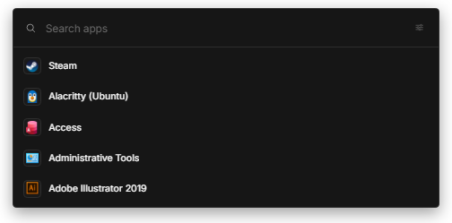

# Ray

A background Windows app with one job: a floating bar that finds and launches your apps.

Press **Ctrl + Space** anywhere in Windows, type a name, press **Enter**.



There is no main window. Ray lives in the notification tray; the bar hides with `Esc`, a click outside, or when it loses focus. A small settings window opens on demand.

## What it does

- **Searches installed apps only.** User and all-users Start menu shortcuts, ClickOnce entries, and Microsoft Store apps from the shell AppsFolder.
- **Real icons.** Shortcut targets are resolved with `WScript.Shell`, then Electron extracts the target executable / DLL icon. Store app logos are read from their package assets.
- **Fresh suggestions on every open.** Recent apps come first, then frequent and alphabetical apps fill the remaining slots, so the last opened app never becomes the whole list. The count is configurable from 1–5 in Settings.
- **Up to ten search results.** Fuzzy matches stay fully visible; the window measures the natural list height so the last row is never cut off. The result cap is configurable from 5–10.
- **Fast fuzzy matching.** Prefix and word-boundary matches rank first, then substrings, then word-start acronyms. Launch history nudges frequently used apps up.
- **Keyboard-first.** `↑` `↓` move, `Enter` opens, `Ctrl + Enter` reveals the shortcut in Explorer, `Esc` closes.
- **Designed to stay out of the way.** The bar is a single field plus a short list. The mouse pointer is visible; the blinking text caret is hidden.

## Settings

Open Settings from the gear at the right of the search field, or from the tray menu.

- **Floating bar on/off.** Turning it off releases `Ctrl + Space` and hides the bar. The tray and Settings stay available.
- **Bar size.** 70%, 80%, 90%, 100%, 110%, or 120%.
- **Recent apps on open.** 1–5 apps, shown before typing.
- **Results while searching.** 5–10 matches, default 10.
- **Launch at login.** Available in the installed build.
- **App index.** Live app count, index status, and a rebuild button.
- **Reset defaults** and **Quit Ray**.

All settings persist in `%APPDATA%\Ray\ray-state.json`.

## Loading

While the first index is being built, the suggestion area uses the [transitions.dev](https://transitions.dev) **Skeleton loader and reveal** component, adapted to vanilla JS and Ray's tokens.


- Five app-row skeletons pulse for 1000ms at 50% opacity.
- When the index is ready, the skeleton fades and blurs out while the real suggestions fade and un-blur in over 400ms with `ease-in-out`, matching the component's `--reveal-*` tokens.
- Ray uses an infinite pulse for the indexing state; the component's default pulse count is preserved in the tokens.
- `prefers-reduced-motion: reduce` removes the pulse and the reveal transitions.

## Run it

```powershell
npm install
npm start
```

The bar opens once on launch so you know it is running. Use the tray icon to show it again, open Settings, rebuild the index, toggle the floating bar, enable launch-at-login (installed build), or quit.

## Build a Windows app

```powershell
npm run dist
```

Outputs in `dist/`:

- `Ray-0.1.0-setup.exe` — NSIS installer
- `Ray-0.1.0-portable.exe` — portable build

The build is not code-signed, so Windows SmartScreen will warn on first launch. `npm run pack` creates an unpacked app directory instead.

## The bar

```
┌──────────────────────────────────────────────┐
│  ⌕  Search apps                          ⚙   │
├──────────────────────────────────────────────┤
│  [icon] Discord                              │
│  [icon] Figma                                │
│  [icon] Google Chrome                        │
└──────────────────────────────────────────────┘
```

No footer, no counts, no section labels, no dropdown, and no uppercase labels. The active row is a flat grey fill; there is no coloured rail. Matching characters use the single OpenCode blue. The bar is an opaque panel.

Drag the bar by the search row — the magnifier and the empty padding around the field are the drag handle. The input and Settings control stay clickable. The bar keeps its position for the session.

## Performance

The bar does not index on every launch:

- The cached index loads immediately at startup.
- A missing index is built once and cached; the skeleton shows while it runs.
- A stale index (older than 24 hours) refreshes a minute after launch, only while the bar is hidden.
- The window is sized to the natural list height and only resized when that height actually changes, not on every keystroke.
- Search runs over the in-memory index with no disk or PowerShell work while typing.
- Keystrokes are coalesced to one render per animation frame, and the window only resizes when its natural list height changes.
- The tray's **Rebuild app index** and Settings' rebuild button force a fresh scan.

## Design

Ray follows the public OpenCode design guidance:

- **Palette:** `#0C0C0C` page, `#161616` panel, `#1A1A1A` subtle fill, `#242424` hover/active, `#2E2E2E` borders, `#6A6A6A` icons, `#8F8F8F` muted, `#AEAEAE` body, `#DBDBDB` emphasis, `#FAFAFA` ink.
- **Accent:** one blue, `#6B8FFF`, for matching characters and focus states only. Toggles are ink on ink, not blue.
- **Type:** InterVariable for all text — input, app names, labels, counts, keycaps and settings.
- **Shape:** square corners, hairline borders, no gradients, glows, or heavy shadows.
- **Windows:** the floating bar and a single settings window; no main library.

The stage bridge remains available, mapped onto the OpenCode palette:

| Stage token | Ray token | Value |
| --- | --- | --- |
| `--stage-bg` | `--oc-bg` | `#0C0C0C` |
| `--stage-fg` | `--oc-ink` | `#FAFAFA` |
| `--stage-muted` | `--oc-muted` | `#8F8F8F` |
| `--stage-border` | `--oc-border` | `#2E2E2E` |
| `--stage-surface` | `--oc-panel` | `#161616` |
| `--stage-accent` | `--oc-link` | `#6B8FFF` |
| `--stage-on-accent` | — | `#FFFFFF` |

## Motion

The bar keeps the original dropdown motion:

| Token | Value |
| --- | --- |
| `--dropdown-open-dur` | `250ms` |
| `--dropdown-close-dur` | `150ms` |
| `--dropdown-pre-scale` | `0.97` |
| `--dropdown-closing-scale` | `0.99` |
| `--dropdown-ease` | `cubic-bezier(0.22, 1, 0.36, 1)` |
| `--press-dur` | `150ms` |
| `--press-scale` | `0.99` (rows) |
| `--hover-dur` | `150ms` |
| `--pulse-dur` | `1000ms` |
| `--pulse-min` | `0.5` |
| `--reveal-dur` | `400ms` |
| `--reveal-blur` | `2px` |
| `--reveal-ease` | `ease-in-out` |

`prefers-reduced-motion: reduce` removes the transforms, pulse, and transitions and closes instantly.

## Files

```
electron/
  main.js                    background process, shortcut, tray, windows, settings
  preload.js                 contextBridge API
  indexer.js                 Start menu + Store indexing, icons, cache
  store.js                   launch history + user settings
  scripts/
    resolve-shortcuts.ps1    resolves .lnk targets
    list-start-apps.ps1      Store apps and logo paths
src/
  spotlight.html             floating bar
  settings.html              settings window
  css/tokens.css             OpenCode palette + stage bridge + motion
  css/spotlight.css          field, results, empty state, bar motion
  css/settings.css           settings layout and controls
  css/skeleton.css           transitions.dev skeleton + reveal
  js/spotlight.js            search, keyboard, launch, open/close, skeleton
  js/settings.js             live settings controls
scripts/
  icons-from-logo.ps1        builds icon.png + icon.ico from the app logo
docs/
  index.html                 landing page
  styles.css
  main.js
  assets/                    screenshots and icons for the site
assets/
  ray-icon.png               source app logo (2048 x 2048)
  tray.png / tray@2x.png     background/tray logo
  icon.png / icon.ico        app icon (window, taskbar, installer)
  fonts/                     bundled InterVariable
```

Data lives in `%APPDATA%\Ray`:

- `index-cache.json` — indexed apps and icons
- `ray-state.json` — launch history and settings

## Landing page

A static landing page lives in `docs/`. Preview it with any static server pointed at `docs/`, for example:

```powershell
npx serve docs
```

The page is written to work on GitHub Pages from the `docs/` folder on `main`.

## Shortcuts

| Key | Action |
| --- | --- |
| `Ctrl + Space` | Show / hide Ray (falls back to `Ctrl + Alt + Space`, then `Ctrl + Shift + Space` if taken) |
| `↑` `↓` | Move selection |
| `Enter` | Open app |
| `Ctrl + Enter` | Reveal the app shortcut in Explorer |
| `Esc` | Hide the bar, or close Settings |

Settings is also available from the gear in the bar and from the tray menu.

## Credits

- Skeleton loader and reveal from [transitions.dev](https://transitions.dev) community components, adapted to vanilla JavaScript and Ray's tokens.
- Interface direction follows OpenCode's public design guidance. Ray is an independent personal launcher and is not affiliated with or endorsed by OpenCode or Anomaly. No OpenCode logo is used.
- **Inter** is the only typeface used in the app, licensed under the SIL Open Font License.
- The background/tray logo lives at `assets/tray.png` (with 2× at `assets/tray@2x.png`). The app logo is `assets/ray-icon.png`; `npm run icons` rebuilds `assets/icon.png` and the multi-size `assets/icon.ico` from it.

## License

MIT for Ray's code. Third-party assets keep their original licenses.
